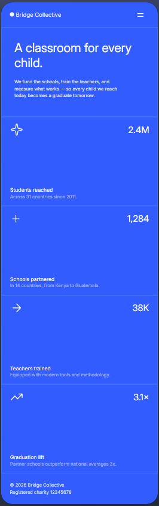
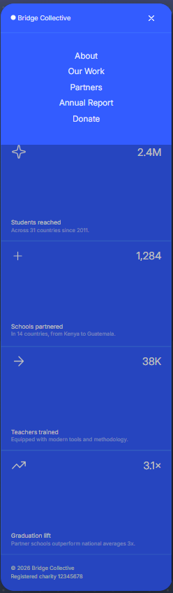
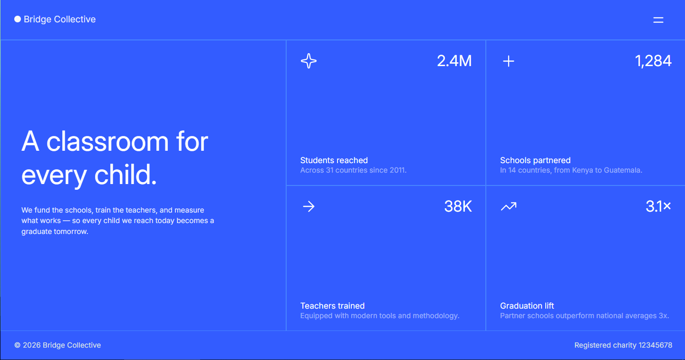
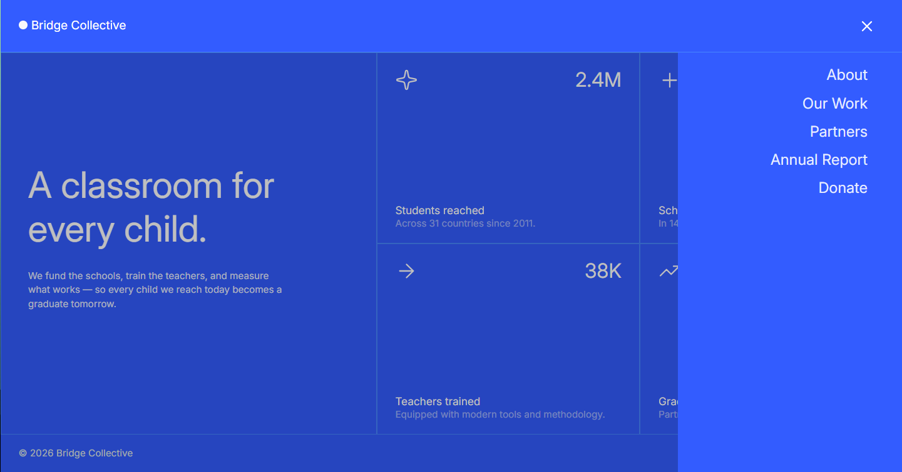

# Grid landing page

landing page com uma grade de estatísticas 2x2, com conteúdos ficticios sobre educação, um layout de título dividido e um menu alternável. Projeto para praticar CSS grid em diferentes breakpoints.






## 🔗 Links

-   Site: [link do deploy](https://RamonDSLOficial.github.io/grid-landing-page)
-   Desafio original: [Frontend Mentor](https://www.frontendmentor.io/challenges/grid-landing-page)

## 🎯 Funcionalidades

-   Ver latout ideal dependendo do tamanho da tela do dispositivo
-   Ver estados de hover para elementos interativos
-   Fechar menu ao clicar no overlay com na tecla de escape 
-   Fechar menu ao clicar na tecla de escape 

## 🛠️ Tecnologias

-   HTML
-   CSS
-   Javascript
-   Bootstrap

## 📚 O que aprendi

-   Utilizar o framework Bootstrap (suas classes e componentes) para criar layouts sofisticados e responsivos de maneira mais rápida
-   Utilizar o componente collapse para criar um menu que abre ao clique no botão
-   Utilizar as classes e componentes do bootstrap em conjunto com código próprio para alcançar efeitos e ações desejadas
```javascript
const myCollapse = document.getElementById('mainMenu')
const bsCollapse = bootstrap.Collapse.getOrCreateInstance(myCollapse)

const closeMenuWithClickInBackdrop = e => {
    const elementTarget = e.target
    if (elementTarget === myCollapse) bsCollapse.hide()
}

const closeMenuWithEscapeKey = e => e.key === 'Escape' && myCollapse.classList.contains('show') && bsCollapse.hide()

myCollapse.addEventListener('click', closeMenuWithClickInBackdrop)
document.addEventListener('keydown', closeMenuWithEscapeKey)
```

## 🚀 Como rodar o projeto

```bash
git clone https://github.com/RamonDSLOficial/grid-landing-page.git
cd seu-repo
npm install
npm run dev
```

## 👤 Autor

-   GitHub - [@RamonDSLOficial](https://github.com/RamonDSLOficial)